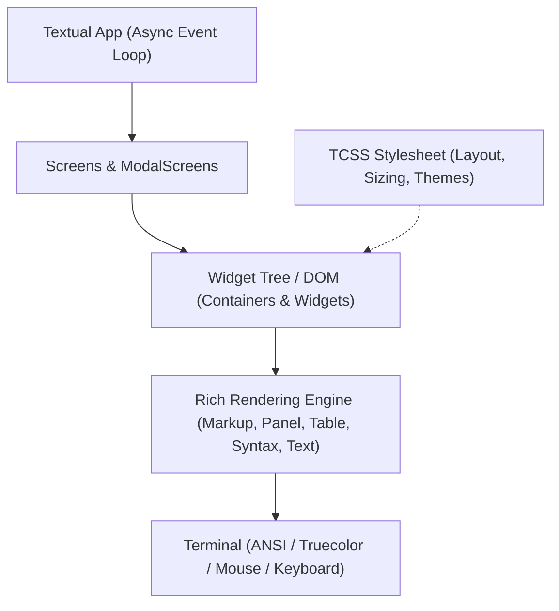

# Building Python TUIs with Rich and Textual

**Rich** and **Textual** are companion Python libraries from Textualize for building modern terminal software. Rich handles styled terminal rendering (colors, markup, tables, syntax highlighting, panels), while Textual builds a full reactive, event-driven Terminal User Interface (TUI) framework on top of Rich—complete with mouse support, CSS-like layout, widgets, screens, and async workers.

---

## 1. How Rich and Textual Fit Together

Textual installs Rich as a dependency and uses Rich's rendering engine under the hood. Every Textual widget ultimately produces Rich renderables (or Textual `Content`) to paint onto the terminal grid.



### When to Use Which

| Need | Use **Rich** | Use **Textual** |
| :--- | :--- | :--- |
| Styled CLI output, logs, tracebacks, progress bars | Yes | No (overkill) |
| Read-only live-updating status screen | Yes (`rich.live.Live`) | Optional |
| Keyboard navigation, mouse clicks, focus, scrolling | No | Yes |
| Forms, buttons, tabs, modals, interactive tables/trees | No | Yes |
| Responsive multi-pane layouts & themes | Limited (`rich.layout`) | Yes (TCSS) |
| Richly formatted cards, code blocks, or custom visuals *inside* an interactive app | **Yes — embedded inside Textual widgets** | **Yes** |

---

## 2. Setup & Project Layout

Python 3.9+ is recommended. Installing `textual` automatically includes `rich`. Install `textual-dev` during development for live CSS reloading and the external debug console.

```bash
# With pip
pip install textual
pip install --upgrade textual-dev

# Or with uv
uv add textual
uv add --dev textual-dev
```

Verify your installation and explore Textual's built-in widget showcase:

```bash
python -m textual
```

### Recommended Structure for Larger Apps

```text
my_tui/
├── pyproject.toml
└── src/
    └── my_tui/
        ├── app.py          # Main App subclass & entry point
        ├── styles.tcss     # External Textual CSS stylesheet
        ├── screens/        # Screen & ModalScreen subclasses
        └── widgets/        # Reusable custom widgets
```

---

## 3. Mastering Rich (The Rendering Layer)

Even in a pure Textual app, knowing Rich's markup and renderables lets you build crisp custom visuals.

### Rich Console Markup

Rich supports BBCode-like inline tags for styles, colors, and hyperlinks:

```python
from rich import print as rprint

rprint("[bold magenta]Status:[/bold magenta] [green]Healthy[/green]")
rprint("[white on blue] Badge [/white on blue] [italic dim]v2.4.0[/italic dim]")
# Escape literal brackets with a backslash
rprint(r"\[INFO] Literal brackets preserved")
```

### Core Rich Renderables

Rich objects implement the renderable protocol and can be printed to a `Console`, placed in a `Live` display, or embedded directly inside Textual widgets:

```python
from rich.console import Console
from rich.panel import Panel
from rich.syntax import Syntax
from rich.table import Table

console = Console()

# 1. Table
table = Table(title="Active Services", expand=True)
table.add_column("Service", style="cyan", no_wrap=True)
table.add_column("Latency", justify="right", style="green")
table.add_column("State", justify="center")
table.add_row("api-gateway", "12 ms", "[bold green]UP[/]")
table.add_row("worker-pool", "48 ms", "[bold yellow]DEGRADED[/]")

# 2. Panel
card = Panel(table, title="Cluster Overview", border_style="bright_blue")
console.print(card)

# 3. Syntax-highlighted code
code = Syntax(
    'def greet(name: str) -> str:\n    return f"Hello, {name}!"',
    "python",
    theme="monokai",
    line_numbers=True,
)
console.print(code)
```

### Lightweight Non-Interactive Dashboards (`rich.live.Live`)

If you only need an auto-refreshing monitor with no mouse/keyboard input, `Live` updates a renderable in place:

```python
import time
from rich.live import Live
from rich.panel import Panel

with Live(Panel("Starting..."), refresh_per_second=4) as live:
    for step in range(1, 6):
        live.update(Panel(f"Processed [bold green]{step * 20}%[/]"))
        time.sleep(0.5)
```

> [!TIP]
> As soon as you want keyboard shortcuts, scrollable panes, clickable buttons, or text input, switch from `rich.live.Live` to **Textual** rather than hand-rolling keyboard listeners.

---

## 4. Core Textual Concepts

### 4.1 App Structure, `compose()`, and Bindings

Every Textual app subclasses `App`, yields its widget hierarchy from `compose()`, declares keyboard shortcuts in `BINDINGS`, and implements matching `action_<name>()` methods.

```python
from textual.app import App, ComposeResult
from textual.binding import Binding
from textual.containers import Center, Vertical
from textual.widgets import Button, Footer, Header, Label


class StarterApp(App):
    TITLE = "Starter TUI"
    SUB_TITLE = "Rich + Textual"

    BINDINGS = [
        Binding("t", "toggle_theme", "Theme"),
        Binding("q", "quit", "Quit"),
    ]

    def compose(self) -> ComposeResult:
        yield Header()
        with Center():
            with Vertical(id="card"):
                yield Label("Press the button or hit [bold]t[/] to switch themes.")
                yield Button("Say Hello", variant="primary", id="hello-btn")
        yield Footer()

    def action_toggle_theme(self) -> None:
        self.theme = (
            "textual-light" if self.theme == "textual-dark" else "textual-dark"
        )
```

> [!NOTE]
> Textual includes a built-in **Command Palette** (`Ctrl+P`) where users can search actions and switch between all built-in themes (`textual-dark`, `textual-light`, `nord`, `gruvbox`, `catppuccin-mocha`, `dracula`, `tokyo-night`, etc.). Use `self.theme` rather than the legacy `self.dark` attribute.

### 4.2 Styling & Layout with TCSS (Textual CSS)

TCSS separates visual design from Python logic. You can inline CSS in `CSS = """..."""` or point to an external `.tcss` file via `CSS_PATH = "styles.tcss"` (recommended for live-reloading during development).

```css
/* styles.tcss */
Screen {
    layout: vertical;
    background: $background;
}

#sidebar {
    dock: left;
    width: 30;
    background: $panel;
    border-right: tall $primary;
    padding: 1 2;
}

#main-grid {
    layout: grid;
    grid-size: 2 1;
    grid-columns: 2fr 1fr;
    grid-gutter: 1 2;
    padding: 1;
}

.card {
    height: 100%;
    border: round $accent;
    background: $surface;
    padding: 1;
}

Button:hover {
    text-style: bold;
}
```

Key TCSS primitives to remember:
- **Units:** cells (`30`), percentages (`50%`), fractions (`1fr`, `2fr`), viewport (`50vw`, `50vh`), `auto`.
- **Docking:** `dock: top | bottom | left | right` pins a widget to a screen/container edge.
- **Containers:** `Horizontal`, `Vertical`, `Grid`, `VerticalScroll`, `HorizontalScroll`, `Container`, `Center`, `Middle`.
- **Theme Variables:** `$primary`, `$secondary`, `$accent`, `$surface`, `$panel`, `$background`, `$success`, `$warning`, `$error`, `$text`, `$text-muted`. Using theme variables ensures your app looks great in every theme.

### 4.3 Events, Selectors, and Custom Messages

Textual dispatches **Messages** up the DOM tree. Use the `@on` decorator with CSS selectors for clean, targeted handlers:

```python
from textual import on
from textual.message import Message
from textual.widget import Widget
from textual.widgets import Button, Input


class TaskForm(Widget):
    # Custom message for child -> parent communication
    class Submitted(Message):
        def __init__(self, title: str) -> None:
            self.title = title
            super().__init__()

    @on(Button.Pressed, "#submit-btn")
    @on(Input.Submitted, "#task-input")
    def handle_submit(self) -> None:
        inp = self.query_one("#task-input", Input)
        if value := inp.value.strip():
            self.post_message(self.Submitted(value))
            inp.value = ""
```

Common DOM query helpers:
- `self.query_one("#my-id", Input)` — returns the single matching widget with full static type checking.
- `self.query(".card")` — returns a `DOMQuery` collection of all matching widgets.

### 4.4 Reactivity (`reactive`)

Reactive attributes automatically repaint a widget or run side effects when their value changes:

```python
from textual.reactive import reactive
from textual.widgets import Static


class CounterBadge(Static):
    count: reactive[int] = reactive(0)

    def validate_count(self, value: int) -> int:
        # Clamp to non-negative values before assignment
        return max(0, value)

    def watch_count(self, old_value: int, new_value: int) -> None:
        # Toggle a CSS class based on state
        self.set_class(new_value == 0, "empty")

    def render(self) -> str:
        return f"[bold]Pending tasks:[/] [cyan]{self.count}[/]"
```

| Hook | Purpose |
| :--- | :--- |
| `validate_<name>(self, value)` | Sanitize/clamp incoming values before storing |
| `watch_<name>(self, old, new)` | React to changes (update sibling widgets, toggle classes, log) |
| `compute_<name>(self)` | Derive a reactive property automatically from other reactives |
| `reactive(default, recompose=True)` | Re-run `compose()` automatically whenever the value changes |

### 4.5 Combining Rich Renderables Inside Textual

There are three primary ways to leverage Rich inside Textual:

1. **Passing Rich renderables to `Static`:**
   ```python
   from rich.panel import Panel
   from rich.syntax import Syntax
   from textual.widgets import Static

   preview = self.query_one("#code-preview", Static)
   preview.update(Panel(Syntax("x = 42", "python", theme="monokai"), title="Preview"))
   ```
2. **Returning a Rich renderable from a custom widget's `render()`:**
   ```python
   from rich.table import Table
   from textual.widget import Widget

   class MetricsCard(Widget):
       def render(self) -> Table:
           table = Table.grid(expand=True)
           table.add_row("[bold]CPU[/]", "[green]14%[/]")
           table.add_row("[bold]RAM[/]", "[yellow]62%[/]")
           return table
   ```
3. **Writing Rich objects to a scrollable `RichLog`:**
   ```python
   log = self.query_one(RichLog)
   log.write("[bold green]Connected[/] to database")
   log.write(Panel("Schema migration complete", border_style="green"))
   ```

> [!IMPORTANT]
> **Rich Table vs. Textual `DataTable`:** Use a Rich `Table` when you only want a non-interactive formatted summary inside a `Static` or `RichLog`. Use Textual's `DataTable` widget whenever users need to scroll large datasets, move a cursor across rows/cells, sort, or select items.

### 4.6 Multi-Screen Navigation & Modal Dialogs

Use `Screen` for full-page views and `ModalScreen[ResultType]` for dialogs/confirmations:

```python
from textual import on
from textual.app import ComposeResult
from textual.containers import Grid
from textual.screen import ModalScreen
from textual.widgets import Button, Label


class ConfirmDeleteScreen(ModalScreen[bool]):
    CSS = """
    ConfirmDeleteScreen {
        align: center middle;
    }
    #dialog {
        grid-size: 2;
        grid-gutter: 1 2;
        width: 48;
        height: 11;
        padding: 1 2;
        border: thick $error;
        background: $surface;
    }
    #question {
        column-span: 2;
        content-align: center middle;
    }
    """

    def __init__(self, item_name: str) -> None:
        super().__init__()
        self.item_name = item_name

    def compose(self) -> ComposeResult:
        with Grid(id="dialog"):
            yield Label(f"Delete [bold]{self.item_name}[/]?", id="question")
            yield Button("Delete", variant="error", id="yes")
            yield Button("Cancel", variant="primary", id="no")

    @on(Button.Pressed, "#yes")
    def confirm(self) -> None:
        self.dismiss(True)

    @on(Button.Pressed, "#no")
    def cancel(self) -> None:
        self.dismiss(False)
```

Calling the modal from your `App` or `Screen`:

```python
def action_delete_selected(self) -> None:
    def on_result(confirmed: bool | None) -> None:
        if confirmed:
            self.notify("Item deleted!", severity="warning")

    self.push_screen(ConfirmDeleteScreen("report.csv"), on_result)
```

### 4.7 Background Tasks with Workers (`@work`)

Never run blocking I/O or CPU-heavy work directly inside an event handler—it freezes the UI. Decorate background operations with `@work`:

```python
import time
from textual import work
from textual.app import App
from textual.widgets import Static


class FetchApp(App):
    # Async worker (for httpx, aiohttp, asyncio, etc.)
    @work(exclusive=True)
    async def fetch_async(self, url: str) -> None:
        # await async client here...
        self.query_one("#status", Static).update(f"Loaded {url}")

    # Threaded worker (for blocking libraries like requests, sqlite3, subprocess)
    @work(thread=True, exclusive=True)
    def run_blocking_job(self) -> None:
        time.sleep(2)
        # Always marshal UI updates from threads back onto the main event loop
        self.call_from_thread(self.notify, "Background job finished!")
```

Setting `exclusive=True` automatically cancels any previous in-flight run of that worker—ideal for search-as-you-type or refresh buttons.

---

## 5. Complete Example: Interactive Task & Log Dashboard

This single-file app brings together Textual widgets (`Header`, `Footer`, `Input`, `DataTable`, `RichLog`, `Static`), TCSS layout, `@on`, `reactive`, `@work`, and Rich renderables (`Panel`, `Table`, markup).

Run the bundled script [`task_dashboard.py`](./task_dashboard.py) with `python task_dashboard.py`:

```python
"""Interactive Task & Activity Dashboard built with Rich and Textual.

This example shows how the two companion libraries work together:
- **Rich** handles styled terminal rendering (inline markup, `Panel`, `Table.grid`,
  and `RenderableType` objects).
- **Textual** provides the interactive TUI framework on top of Rich (an async event
  loop, a widget DOM tree, CSS-like layout via TCSS, reactive state, keyboard
  bindings, and background workers).

Run normally:
    python task_dashboard.py

Run with live CSS reload and debug console support (requires `textual-dev`):
    textual run --dev task_dashboard.py
"""

from __future__ import annotations

import asyncio
from datetime import datetime
from typing import ClassVar

# --- Rich imports (the visual rendering layer) ---
# RenderableType is a typing alias for anything Rich can draw (markup strings,
# Panel, Table, Syntax, Text, etc.).
from rich.console import RenderableType
from rich.panel import Panel
from rich.table import Table

# --- Textual imports (the interactive TUI application layer) ---
# `on` binds message handlers using CSS selectors; `work` runs background tasks
# without freezing the UI.
from textual import on, work
from textual.app import App, ComposeResult
from textual.binding import Binding, BindingType
from textual.containers import Horizontal, Vertical
from textual.reactive import reactive
from textual.widgets import Button, DataTable, Footer, Header, Input, RichLog, Static


# ---------------------------------------------------------------------------
# Custom Widget: Combining Textual Reactivity with Rich Renderables
# ---------------------------------------------------------------------------
# Subclass `Static` when creating a custom widget whose job is to render text
# or a Rich renderable (such as a Panel, Table, or Syntax block).
class SummaryCard(Static):
    """Custom widget that renders a Rich Panel + Table from reactive state."""

    # Textual `reactive` descriptors automatically schedule a repaint (calling
    # `render()`) whenever their values change—no manual `refresh()` needed.
    # You can also add `validate_<name>` or `watch_<name>` methods for
    # validation or side effects.
    total: reactive[int] = reactive(0)
    completed: reactive[int] = reactive(0)

    def render(self) -> Panel:
        """Build and return a Rich renderable whenever reactive state changes.

        Returning a Rich object directly from `render()` is one of the cleanest
        ways to embed Rich visuals inside a Textual layout.
        """
        pending = self.total - self.completed

        # `Table.grid()` creates a borderless, headerless Rich Table—ideal for
        # neatly aligning key/value pairs inside a Panel.
        # `expand=True` stretches the grid to fill the widget's available width;
        # `padding=(0, 1)` adds 0 vertical and 1 horizontal cell of spacing.
        grid = Table.grid(expand=True, padding=(0, 1))
        grid.add_column(style="bold")
        grid.add_column(justify="right")

        # Rich Console Markup uses BBCode-like tags (`[cyan]...[/]`). The bare
        # `[/]` closing tag automatically closes the most recently opened style.
        grid.add_row("Total Tasks", f"[cyan]{self.total}[/]")
        grid.add_row("Completed", f"[green]{self.completed}[/]")
        grid.add_row("Pending", f"[yellow]{pending}[/]")

        # Wrap the grid in a Rich Panel with a title and colored border.
        return Panel(grid, title="Overview", border_style="cyan")


# ---------------------------------------------------------------------------
# Main Application: Layout (TCSS), Widgets (DOM), Events, and Async Workers
# ---------------------------------------------------------------------------
class TaskDashboard(App):
    # `TITLE` and `SUB_TITLE` are automatically displayed by the `Header` widget.
    # They are reactive attributes on `App`, so changing `self.sub_title` at
    # runtime updates the header immediately.
    TITLE = "Task & Activity Dashboard"
    SUB_TITLE = "Rich + Textual Demo"

    # Textual CSS (TCSS) separates layout and visual styling from Python logic.
    # For larger apps, move this into a `styles.tcss` file and set
    # `CSS_PATH = "styles.tcss"` so `textual run --dev` can hot-reload changes.
    CSS = """
    /* The root Screen stacks its direct children vertically by default. */
    Screen {
        layout: vertical;
    }

    /* `#id` selects a widget by its `id="..."` attribute.
       `height: auto` sizes the bar to fit its children.
       `$panel` and `$primary` are built-in theme variables that adapt
       automatically when the user switches themes. */
    #top-bar {
        height: auto;
        padding: 1 2; /* 1 cell top/bottom, 2 cells left/right */
        background: $panel;
        border-bottom: solid $primary;
    }

    /* Fractional units (`1fr`) claim all remaining space not used by siblings,
       so the Input stretches while the Buttons stay at their natural width. */
    #task-input {
        width: 1fr;
        margin-right: 1;
    }

    /* `height: 1fr` fills the vertical space between `#top-bar` and `Footer`. */
    #body {
        height: 1fr;
        padding: 1 2;
    }

    /* `2fr` vs `1fr` creates a responsive 2:1 split across the terminal width. */
    #left-pane {
        width: 2fr;
        margin-right: 1;
    }

    #right-pane {
        width: 1fr;
    }

    /* Type selectors target every instance of a widget class.
       `border: round $primary` draws rounded Unicode box-drawing corners. */
    DataTable {
        height: 1fr;
        border: round $primary;
    }

    SummaryCard {
        height: auto;
        margin-bottom: 1;
    }

    RichLog {
        height: 1fr;
        border: round $accent;
        background: $surface;
        padding: 0 1;
    }
    """

    # `BINDINGS` maps keys to `action_<name>` methods on this class and
    # automatically displays them in the `Footer` bar and Command Palette (Ctrl+P).
    # Annotate with `ClassVar[list[BindingType]]` to match `App.BINDINGS` and
    # satisfy linters (e.g. Ruff RUF012) and type checkers.
    # Note: `"quit"` calls Textual's built-in `App.action_quit()`.
    BINDINGS: ClassVar[list[BindingType]] = [
        Binding("space", "toggle_task", "Toggle Done"),
        Binding("s", "sync_tasks", "Sync"),
        Binding("t", "toggle_theme", "Theme"),
        Binding("q", "quit", "Quit"),
    ]

    def __init__(self) -> None:
        super().__init__()
        # Keep application state separate from widgets; widgets act as views.
        # Note: The widget DOM does not exist yet in `__init__`, so never call
        # `query_one()` here—do widget initialization in `on_mount()` instead.
        self._tasks: dict[str, dict[str, str | bool]] = {}
        self._next_id = 1

    def compose(self) -> ComposeResult:
        """Build the initial Widget Tree (DOM) by yielding widgets.

        Use container context managers (`with Horizontal():`, `with Vertical():`)
        to nest child widgets inside layout containers.
        """
        # `Header` and `Footer` dock themselves to the top and bottom edges.
        yield Header(show_clock=True)

        # Horizontal arranges its yielded children side-by-side (left to right).
        with Horizontal(id="top-bar"):
            yield Input(placeholder="Add a new task and press Enter...", id="task-input")
            # `variant` applies semantic theme styling (primary, success, warning, error).
            yield Button("Add Task", variant="primary", id="add-btn")
            yield Button("Sync", variant="success", id="sync-btn")

        with Horizontal(id="body"):
            with Vertical(id="left-pane"):
                # Use Textual's `DataTable` (instead of a Rich `Table`) whenever
                # you need scrolling, keyboard focus, or row/cell selection.
                # `cursor_type="row"` highlights the entire row under the cursor.
                yield DataTable(cursor_type="row", id="task-table")
            with Vertical(id="right-pane"):
                yield SummaryCard(id="summary")
                # `RichLog` is a scrollable viewport for Rich output:
                # - `markup=True` parses Rich tags like `[bold cyan]...[/]`
                # - `highlight=True` auto-styles numbers, paths, and keywords
                yield RichLog(markup=True, highlight=True, id="activity-log")

        yield Footer()

    def on_mount(self) -> None:
        """Lifecycle hook run once all composed widgets are mounted in the DOM."""
        # `query_one(selector, WidgetType)` looks up a single widget via CSS
        # selector and verifies its type for both runtime safety and type checkers.
        table = self.query_one("#task-table", DataTable)

        # Giving each column a stable `key` lets us update cells by name
        # (e.g. `"status"`) instead of relying on fragile numeric indexes.
        table.add_column("ID", key="id")
        table.add_column("Task", key="task")
        table.add_column("Status", key="status")

        self._add_task("Design TCSS layout")
        self._add_task("Embed Rich summary card")
        self._add_task("Write pytest Pilot tests")
        self._log("[bold cyan]Dashboard ready.[/] Press [bold]Space[/] to toggle a task.")

    def _log(self, message: RenderableType) -> None:
        """Write either a Rich markup string or any Rich renderable to RichLog.

        Never call `print()` inside a Textual app—Textual owns the terminal
        screen. Use a `RichLog` widget for user-facing logs, or `self.log(...)`
        to stream debug messages to `textual console`.
        """
        rich_log = self.query_one("#activity-log", RichLog)
        if isinstance(message, str):
            ts = datetime.now().strftime("%H:%M:%S")
            rich_log.write(f"[dim]{ts}[/] {message}")
        else:
            # RichLog accepts full Rich renderables like Panel, Table, or Syntax.
            rich_log.write(message)

    def _refresh_summary(self) -> None:
        """Update SummaryCard's reactive attributes to trigger an automatic repaint."""
        summary = self.query_one("#summary", SummaryCard)
        summary.total = len(self._tasks)
        summary.completed = sum(1 for t in self._tasks.values() if t["done"])

    def _add_task(self, title: str) -> None:
        row_key = f"T-{self._next_id:02d}"
        self._next_id += 1
        self._tasks[row_key] = {"title": title, "done": False}

        table = self.query_one("#task-table", DataTable)
        # Passing `key=row_key` associates the row with a stable identifier so
        # we can update it later even if rows are sorted or removed.
        # DataTable cells natively render Rich markup strings like `[yellow]`.
        table.add_row(row_key, title, "[yellow]Pending[/]", key=row_key)
        self._refresh_summary()
        self._log(f"Added [bold]{row_key}[/]: {title}")

    # Textual widgets communicate by posting Message objects up the DOM tree.
    # `@on(MessageClass, "css-selector")` routes matching messages to a method,
    # and decorators can be stacked so clicking the button OR pressing Enter
    # inside the Input runs the exact same handler.
    @on(Button.Pressed, "#add-btn")
    @on(Input.Submitted, "#task-input")
    def handle_add_task(self) -> None:
        # The event parameter is optional when the handler doesn't need it.
        inp = self.query_one("#task-input", Input)
        if title := inp.value.strip():
            self._add_task(title)
            inp.value = ""

    @on(Button.Pressed, "#sync-btn")
    def handle_sync_button(self) -> None:
        # Delegate to the action method so the button and `s` shortcut share one path.
        self.action_sync_tasks()

    # Action methods are named `action_<binding_action>` and invoked by BINDINGS.
    def action_toggle_task(self) -> None:
        table = self.query_one("#task-table", DataTable)
        if table.row_count == 0:
            return

        # Convert the cursor's visual (row, col) coordinate into our stable
        # RowKey so lookups stay accurate even if rows are reordered or deleted.
        row_key = table.coordinate_to_cell_key(table.cursor_coordinate).row_key
        key_str = str(row_key.value)
        task = self._tasks[key_str]
        task["done"] = not task["done"]

        status = "[bold green]Done[/]" if task["done"] else "[yellow]Pending[/]"
        # Update a single cell in place by (row_key, column_key) instead of
        # clearing and rebuilding the entire table.
        table.update_cell(row_key, "status", status)
        self._refresh_summary()
        self._log(f"Marked [bold]{key_str}[/] as {status}")

    # `@work` runs slow/async operations as a managed Textual Worker so the UI
    # stays responsive (never call blocking `time.sleep()` or `requests.get()`
    # on the event loop; for blocking libraries use `@work(thread=True)` and
    # marshal UI updates back with `self.call_from_thread(...)`).
    # `exclusive=True` automatically cancels any previous in-flight sync if
    # triggered again before finishing.
    @work(exclusive=True)
    async def action_sync_tasks(self) -> None:
        self._log("[italic]Syncing with remote...[/]")
        await asyncio.sleep(1.0)
        # `self.notify()` shows a built-in non-blocking toast notification.
        self.notify("Tasks synced!", title="Sync Complete")
        # RichLog can display rich structured components like a Rich Panel.
        self._log(Panel("Remote state is up to date.", border_style="green"))

    def action_toggle_theme(self) -> None:
        # Changing `self.theme` re-evaluates all TCSS `$variable` colors live.
        # Users can also pick any built-in theme via the Command Palette (Ctrl+P).
        self.theme = (
            "textual-light" if self.theme == "textual-dark" else "textual-dark"
        )


if __name__ == "__main__":
    # `.run()` enters Textual's async event loop, switches to the terminal's
    # alternate screen buffer, enables mouse/keyboard events, and restores the
    # terminal cleanly when the app exits.
    TaskDashboard().run()
```

---

## 6. Debugging, DevTools & Automated Testing

### Live Dev Console & Hot-Reloading CSS

Because Textual owns the terminal screen, `print()` cannot be used for debugging. Instead, use `textual-dev` across two terminals:

1. **Terminal 1** — Start the debug console:
   ```bash
   textual console
   ```
2. **Terminal 2** — Run your app in dev mode:
   ```bash
   textual run --dev task_dashboard.py
   ```

> [!NOTE]
> **Windows CLI note:** If `textual` isn't recognized on Windows (when Python's `Scripts` folder isn't on `PATH`), invoke the module directly via Python:
> - `python -m textual_dev.cli console` and `python -m textual_dev.cli run --dev task_dashboard.py` (for the `textual-dev` CLI)
> - `python -m textual` launches Textual's built-in demo showcase (`DemoApp`), not the `textual-dev` CLI.

Inside your app, call `self.log("value =", some_var)` or `from textual import log; log(locals())` to stream structured Rich-formatted diagnostics to Terminal 1. Editing an external `.tcss` file updates the running app immediately without restarting.

### Headless Automated Testing (`run_test` + `Pilot`)

Textual ships with an async test harness so you can test keystrokes, clicks, and DOM state in CI without a real terminal:

```python
import pytest
from textual.widgets import DataTable

from task_dashboard import TaskDashboard


@pytest.mark.asyncio
async def test_add_task():
    app = TaskDashboard()
    async with app.run_test(size=(100, 30)) as pilot:
        await pilot.click("#task-input")
        await pilot.press(*"Ship v1.0", "enter")
        await pilot.pause()

        table = app.query_one("#task-table", DataTable)
        assert table.row_count == 4
```

Run with `pytest` (requires `pytest` and `pytest-asyncio`).

---

## 7. Built-In Widget Quick Reference

| Category | Widgets |
| :--- | :--- |
| **Display & Rich** | `Static`, `Label`, `Pretty`, `Markdown`, `MarkdownViewer`, `RichLog`, `Sparkline`, `Digits`, `ProgressBar`, `LoadingIndicator` |
| **Input & Forms** | `Input`, `TextArea`, `Button`, `Checkbox`, `Switch`, `RadioSet`, `Select`, `SelectionList`, `OptionList` |
| **Data & Navigation** | `DataTable`, `Tree`, `DirectoryTree`, `TabbedContent`, `Tabs`, `Collapsible`, `ContentSwitcher` |
| **Chrome & Layout** | `Header`, `Footer`, `Horizontal`, `Vertical`, `Grid`, `VerticalScroll`, `Rule` |

---

## 8. Common Pitfalls & Best Practices

> [!WARNING]
> - **Never call `print()`** inside a Textual app—it writes raw bytes over Textual's managed terminal buffer. Use `self.log(...)`, `self.notify(...)`, or a `RichLog` widget.
> - **Never block the event loop** with `time.sleep()`, `requests.get()`, or heavy loops inside event handlers. Offload them to `@work(thread=True)` (or use async libraries inside `@work`).
> - **Don't mix `rich.layout.Layout` with Textual layouts.** Use Textual containers and TCSS for layout, and reserve Rich for leaf renderables (`Panel`, `Table`, `Syntax`, `Text`, markup).
> - **Use theme variables** (`$surface`, `$primary`, `$accent`, `$error`) instead of hardcoded hex colors so your TUI adapts cleanly to light and dark themes.
> - **Prefer external `.tcss` files** once your stylesheet exceeds ~30 lines—you get editor syntax highlighting and instant live-reload under `textual run --dev`.
