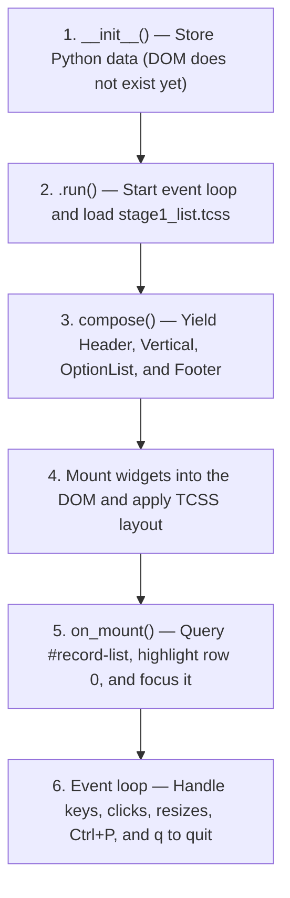

# Stage 1: Displaying a List of Dictionaries

- **Code:** [`stage1_list.py`](./stage1_list.py)
- **Stylesheet:** [`stage1_list.tcss`](./stage1_list.tcss)
- **Run:** `python stages/stage1_list.py`

If this is your **first time using Textual**, start right here. Stage 1 builds the smallest complete Textual app: taking a predefined Python `list[dict]` and displaying it as a clean, keyboard- and mouse-navigable list in your terminal.

---

## What Is Textual? (Quick Mental Model)

In a traditional Python CLI script, your code runs top-to-bottom—calling `print()` to write lines and `input()` to wait for text.

**Textual** works more like a modern web or desktop UI framework, right inside your terminal:
- **Widgets & the DOM:** Your interface is built from reusable **widgets** (headers, lists, inputs, buttons, containers) arranged in a parent–child tree called the **DOM** (Document Object Model), similar to HTML elements.
- **TCSS (Textual CSS):** Sizing, borders, spacing, and theme colors live in a CSS-like `.tcss` stylesheet, keeping visual layout separate from Python logic.
- **Event Loop:** When you call `app.run()`, Textual switches the terminal into full-screen mode, draws your widgets, and continuously listens for keyboard presses, mouse clicks, and terminal resizes—restoring your terminal cleanly when you quit.

> [!IMPORTANT]
> Because Textual manages the entire terminal screen while running, **never call `print()`** inside a Textual app—it writes raw text over the UI. (Later stages show `self.notify()` and Rich widgets for displaying output, and `textual console` for debugging.)

---

## Quick Start: Install & Run Stage 1

Make sure Textual is installed (installing `textual` also installs `rich` automatically):

```bash
pip install textual
```

Run Stage 1 from the repository root:

```bash
python stages/stage1_list.py
```

*(Optional)* For live CSS hot-reloading during development, install `textual-dev` (`pip install textual-dev`) and run:

```bash
textual run --dev stages/stage1_list.py
# Windows fallback if `textual` isn't on PATH:
python -m textual_dev.cli run --dev stages/stage1_list.py
```

### What You'll See & Controls That Already Work

```text
┌─────────────────── Stage 1: Item List — Displaying a list[dict] ───────────────────┐
│                                                                                    │
│  ╭─ Items (3) ──────────────────────────────────────────────────────────────────╮  │
│  │ 1. ada_lovelace                                                              │  │
│  │ 2. grace_hopper                                                              │  │
│  │ 3. alan_turing                                                               │  │
│  ╰──────────────────────────────────────────────────────────────────────────────╯  │
│                                                                                    │
└ q Quit                                                                ^p palette ──┘
```

Even with ~100 lines of beginner code, Textual gives you all of this out of the box:
- **`↑` / `↓` arrow keys** or **mouse click / scroll** to move the highlight through the list.
- **`Ctrl+P`** to open Textual's built-in **Command Palette** (try switching themes live!).
- **`q`** to quit cleanly and return to your shell prompt.

---

## How Textual Starts Your App (Lifecycle)

Before diving into individual lines, it helps to know the exact order Textual executes your methods when `Stage1ListApp(DEFAULT_RECORDS).run()` runs:



Keep steps **1**, **3**, and **5** separate in your head—they are the backbone of almost every Textual app you will ever write.

---

## Code Walkthrough (`stage1_list.py`)

### 1. Imports and Sample Data

```python
from __future__ import annotations

from typing import ClassVar

from textual.app import App, ComposeResult
from textual.binding import Binding, BindingType
from textual.containers import Vertical
from textual.widgets import Footer, Header, OptionList
```

Where each Textual import lives:
- `textual.app` — `App` (the base class for every Textual app) and `ComposeResult` (the return type annotation for `compose()`).
- `textual.binding` — `Binding` (declares a keyboard shortcut) and `BindingType` (type alias matching `App.BINDINGS`).
- `textual.containers` — Layout containers like `Vertical` (stacks children top-to-bottom) and `Horizontal` (places children side-by-side).
- `textual.widgets` — Built-in UI controls: `Header`, `Footer`, and `OptionList`.

Next, `DEFAULT_RECORDS` defines a plain Python list of dictionaries (`FormRecord = dict[str, str | int | float | bool]`). Notice there is nothing Textual-specific about the data itself—Textual wraps your regular Python data structures.

### 2. Subclassing `App[None]`

Every Textual application subclasses `textual.app.App`:

```python
class Stage1ListApp(App[None]):
    TITLE = "Stage 1: Item List"
    SUB_TITLE = "Displaying a list[dict] with OptionList"
    CSS_PATH = "stage1_list.tcss"
```

- **`App[None]`**: `App` is generic over the return type of `app.run()`. Writing `App[None]` tells Python and type checkers that `app.run()` returns `None` (if an app called `self.exit(result)` to return a value on exit, you would write `App[ResultType]`).
- **`TITLE` & `SUB_TITLE`**: Special class attributes automatically read by the `Header` widget at the top of the screen.
- **`CSS_PATH`**: Points Textual to the external `.tcss` stylesheet file. Textual resolves relative paths against the Python file's folder, so running `python stages/stage1_list.py` from any directory still finds `stage1_list.tcss`.

### 3. Keyboard Shortcuts (`BINDINGS`)

`BINDINGS` declares app-wide keyboard shortcuts and automatically displays them in the `Footer` bar and Command Palette (`Ctrl+P`):

```python
BINDINGS: ClassVar[list[BindingType]] = [
    Binding("q", "quit", "Quit"),
]
```

Each `Binding(key, action, description)` takes three main pieces:
1. **Key (`"q"`)** — the key (or combo like `"ctrl+f"`) that triggers the shortcut.
2. **Action (`"quit"`)** — tells Textual to call a method named `action_<name>()` on the app. Here, `"quit"` maps to Textual's built-in `App.action_quit()`, so you don't even have to write it yourself.
3. **Description (`"Quit"`)** — the human-readable label displayed in the `Footer`.

> [!NOTE]
> **Why `ClassVar[list[BindingType]]`?** In Python, putting a mutable `list` directly on a class triggers linter warnings (like Ruff `RUF012`) because class attributes are shared across instances. Textual intentionally reads `BINDINGS` from the class itself (`App.BINDINGS` is typed as `ClassVar[list[BindingType]]`), so adding this annotation keeps both linters and type checkers happy.

### 4. Initializing Data in `__init__()`

```python
def __init__(self, initial_records: list[FormRecord]) -> None:
    if not initial_records:
        raise ValueError("initial_records must contain at least one dictionary.")
    super().__init__()
    self._records: list[FormRecord] = [dict(rec) for rec in initial_records]
```

Three important details here:
- **Always call `super().__init__()`** — `App.__init__()` sets up Textual's internal CSS engine, message queue, and screen stack. Skipping it will break the app.
- **Copy the caller's data** (`[dict(rec) for rec in initial_records]`) — so later edits don't accidentally mutate the original `DEFAULT_RECORDS` list.
- **Don't touch widgets in `__init__()`** — `compose()` hasn't run yet, so trying to look up `#record-list` here would raise a `NoMatches` error.

The helper `_record_label(index, record)` then formats each dictionary into a single display line (e.g., `"1. ada_lovelace"`) by grabbing the first value in the dictionary with `next(iter(record.values()), ...)`.

### 5. Building the Widget Tree in `compose()`

`compose()` describes **what** appears on screen and **how widgets are nested**:

```python
def compose(self) -> ComposeResult:
    yield Header()

    with Vertical(id="workspace"):
        labels = [self._record_label(i, rec) for i, rec in enumerate(self._records)]
        option_list = OptionList(*labels, id="record-list")
        option_list.border_title = f"Items ({len(self._records)})"
        yield option_list

    yield Footer()
```

This creates the following widget tree (DOM):

```text
Screen
├── Header                      (docked to top edge)
├── Vertical (#workspace)       (fills middle area)
│   └── OptionList (#record-list)
└── Footer                      (docked to bottom edge)
```

Key concepts in `compose()`:
- **`Header()` and `Footer()`**: Built-in widgets that automatically pin ("dock") themselves to the top and bottom of the screen.
- **`id="..."`**: Assigns a unique name to a widget (like HTML `id`). We use `#workspace` and `#record-list` both in `stage1_list.tcss` (for styling) and in `on_mount()` (for looking up the widget in Python).
- **`OptionList(*labels, id="record-list")`**: Unpacks the list of formatted strings into selectable rows with built-in keyboard navigation and scrolling.
- **`option_list.border_title`**: Places the text `"Items (3)"` neatly inside the top border drawn by TCSS.

#### `return` vs. `yield` in `compose()`

If you're used to regular Python functions, you might wonder why `compose()` uses `yield` instead of `return` (while `_record_label()` right above it uses `return`):

| | `return` | `yield` |
| :--- | :--- | :--- |
| **How many values** | Sends back **one** value (e.g., a single string in `_record_label()`) | Produces a **sequence** of values one at a time (a generator) |
| **Function lifetime** | **Exits immediately** and discards local state | **Pauses** at the `yield` line, keeps local state alive, and **resumes** on the next step |
| **Inside a `with` block** | Closes the `with` block immediately on exit | Keeps the `with` block **active** across multiple `yield` statements |

Why Textual relies on `yield` in `compose()`:
1. **Multiple widgets without building lists by hand:** `compose()` streams `Header()`, then the workspace widgets, then `Footer()` cleanly in top-to-bottom order.
2. **Context-manager nesting (`with Vertical(...):`):** Because `yield` pauses *inside* the `with` block instead of exiting the function, Textual knows that every widget yielded while inside `with Vertical(id="workspace"):` belongs as a **child** of `#workspace`. When execution leaves the `with` block, Textual automatically closes that container before yielding `Footer()`. With `return`, the function would terminate on the very first widget and couldn't express nested parent/child layouts this way.
3. **Shortcut for many widgets (`yield from`):** In later stages, you'll also see `yield from self._build_field_rows(...)`, which yields every widget in a list one by one inside the active container.

### 6. Post-Mount Setup in `on_mount()`

Once Textual finishes building and mounting every widget from `compose()`, it calls `on_mount()`:

```python
def on_mount(self) -> None:
    option_list = self.query_one("#record-list", OptionList)
    option_list.highlighted = 0
    option_list.focus()
```

- **`self.query_one("#record-list", OptionList)`**: Searches the DOM using a CSS selector (`#record-list`) and verifies the result is an `OptionList`. Passing the widget class gives you both runtime safety and full IDE autocomplete/type checking.
- **`option_list.highlighted = 0`**: Highlights the first row (0-indexed) immediately on startup.
- **`option_list.focus()`**: Gives keyboard **focus** to the `OptionList`. In a TUI, focus determines which widget receives keystrokes—without focusing it, pressing `↑`/`↓` wouldn't move the selection until you clicked the list or pressed `Tab`.

### 7. Starting the App

```python
if __name__ == "__main__":
    Stage1ListApp(DEFAULT_RECORDS).run()
```

Calling `.run()` hands control to Textual's event loop until the user quits (`q` or `Ctrl+C`).

---

## Stylesheet Walkthrough (`stage1_list.tcss`)

Even if you have never written CSS before, Textual CSS (**TCSS**) only takes a handful of rules to get great layouts. Here is the entire Stage 1 stylesheet:

```css
/* Selectors used in this file:
 * - Type selector (e.g. `Screen`): targets every widget of that class.
 * - ID selector (`#name`): starts with `#` and targets the single widget
 *   created with `id="name"` in `compose()`.
 */

/* Type selector: stack Header, #workspace, and Footer vertically. */
Screen {
    layout: vertical;
}

/* ID selector: targets `Vertical(id="workspace")` from `compose()`. */
#workspace {
    height: 1fr;        /* Fill all remaining vertical space */
    padding: 1 2;       /* 1 cell top/bottom, 2 cells left/right */
}

/* ID selector: targets `OptionList(..., id="record-list")` from `compose()`. */
#record-list {
    height: 1fr;            /* Expand to fill the workspace height */
    border: round $accent;  /* Rounded border with border_title support */
}
```

How to read each part:
- **Comments (`/* ... */`)**: TCSS uses CSS-style block comments. Never use `#` for comments—in TCSS, `#` starts an ID selector!
- **Selectors**:
  - `Screen` (no prefix) is a **type selector** matching the root `Screen` widget.
  - `#workspace` and `#record-list` (`#` prefix) are **ID selectors** matching widgets created with `id="workspace"` and `id="record-list"` in `compose()`.
- **`layout: vertical;`**: Tells `Screen` to stack its children from top to bottom.
- **`height: 1fr;`**: `fr` stands for **fractional unit**. It tells the widget to expand and take all leftover height not claimed by fixed-size siblings (`Header` and `Footer`), automatically resizing when you drag your terminal window larger or smaller.
- **`padding: 1 2;`**: Adds inner spacing measured in **terminal character cells**—`1` row above/below and `2` columns left/right.
- **`border: round $accent;`**: Draws rounded Unicode box corners around `#record-list` using the active theme's `$accent` color variable instead of a hardcoded color.

### Understanding ID Selectors (`#name`)

An **ID selector** (`#name`) is how you target one specific, uniquely named widget across both **TCSS** and **Python**. You assign the name once with `id="..."` in `compose()`, and then reference it with a `#` prefix everywhere else:

1. **Assign the ID in Python (`compose()`):**
   ```python
   option_list = OptionList(*labels, id="record-list")
   ```
2. **Style that widget in TCSS (`stage1_list.tcss`):**
   ```css
   #record-list {
       height: 1fr;
       border: round $accent;
   }
   ```
3. **Query that widget in Python (`on_mount()`):**
   ```python
   option_list = self.query_one("#record-list", OptionList)
   ```

Good rules of thumb for ID selectors:
- **Keep IDs unique per screen:** An `id` is meant to identify one specific widget (like `#workspace`, `#record-list`, or `#filter-input` in Stage 2). If you need to style **multiple** similar widgets the same way (like every row in a form in Stage 4), use a **class selector** (`.form-row` with `classes="form-row"`) instead.
- **ID naming rules:** Use letters, numbers, hyphens (`-`), and underscores (`_`), starting with a letter or underscore (hyphens like `record-list` are the standard TCSS convention).
- **Same syntax in `@on` decorators:** Starting in Stage 2, you will also pass ID selectors directly into `@on(Input.Changed, "#filter-input")` so event handlers only listen to that exact widget.

---

## Try It Yourself (Quick Experiments)

Before moving to Stage 2, try a few quick tweaks to see how Textual responds:

1. **Switch themes live:** Run `python stages/stage1_list.py`, press `Ctrl+P`, type `theme`, and pick `nord`, `dracula`, or `textual-light`—watch `$accent` and the header/footer adapt automatically.
2. **Add another dictionary:** Append a 4th dict to `DEFAULT_RECORDS` in [`stage1_list.py`](./stage1_list.py) and re-run—the title updates to `Items (4)` automatically.
3. **Experiment with borders:** In [`stage1_list.tcss`](./stage1_list.tcss), change `border: round $accent;` to `border: heavy $primary;` or `border: double $success;`.
4. **Add a live clock:** Change `yield Header()` to `yield Header(show_clock=True)` in `compose()`.

---

**Navigation:** [Stages Index](./README.md) | [Next: Stage 2 — Live Filter →](./stage2_README.md)
